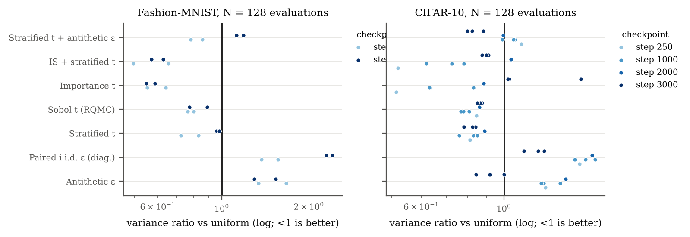

# Monte Carlo variance reduction for diffusion-model training

**In one sentence:** the DDPM training loss is a Monte Carlo average, just like an option price, so the
variance-reduction toolkit of computational finance (antithetic variates, stratified / quasi-Monte Carlo
sampling, importance sampling) plugs straight into diffusion training. This project measures, at equal compute,
how much gradient variance each technique removes and whether that makes training faster or better.
**Short answer:** stratified (and scrambled-Sobol) timesteps remove 11–24% of the gradient variance at
every probed checkpoint, at no cost. That is too little to change FID or held-out loss within our budget.
Antithetic noise pairs are strongly anti-correlated (ρ ≈ −0.7) yet *increase* variance at 6 of 8 CIFAR-10
probes (up to +46%), because each pair shares one image and one timestep. Loss-based importance sampling
of timesteps halves the variance early in training, but on CIFAR-10 it increases it by the end. It gave the
best held-out loss and FID on CIFAR-10, but not significantly with 3 seeds; on Fashion-MNIST the gain was
nominally significant (p = 0.04, uncorrected). A gradient-norm importance proposal cuts variance to ~0.54× at
fixed parameters (measured post hoc; not trained). A law-of-total-variance decomposition explains all of this:
only 6% of the gradient variance is between timesteps.



<!-- RESULTS:BEGIN -->
| Estimator (CIFAR-10, 3,000 steps) | grad-variance ratio @3000 | held-out loss ×10⁻³ | FID-10k @3000 | ms/step |
|---|---|---|---|---|
| Uniform (baseline) | 1 (reference) | 37.50 ± 0.18 | 141.0 ± 5.7 | 90.8 |
| Antithetic ε | 0.92 ± 0.08 | 37.75 ± 0.02 | 143.3 ± 3.0 | 91.0 |
| Stratified t | 0.82 ± 0.03 | 37.70 ± 0.22 | 140.0 ± 2.8 | 90.4 |
| Importance t (loss-based) | 1.22 ± 0.34 | 36.92 ± 0.32 | 135.3 ± 4.1 | 92.2 |
| Stratified t + antithetic ε | 0.83 ± 0.04 | 37.65 ± 0.19 | 141.2 ± 3.7 | 89.4 |
| Sobol t (probe only) | 0.86 ± 0.01 | – | – | – |
| Oracle gradient-norm IS, predicted from decomposition (CIFAR-10) | 0.62 | – | – | – |
| Oracle gradient-norm IS, *measured* post hoc (Fashion-MNIST, fixed θ) | 0.54 | – | – | – |

Mean ± sd over seeds (strat+anti FID: 2 seeds). No held-out-loss or FID difference is significant on CIFAR-10 (pre-registered Welch tests: smallest p = 0.07 for held-out loss, 0.24 for FID, both importance sampling). On Fashion-MNIST importance sampling lowers held-out loss with p = 0.04 (uncorrected; not significant after Bonferroni). Variance decomposition at step 3000: between-timestep 6%, data-given-t 44%, noise 50%; antithetic correlation ρ = -0.71. GPU used: 1.97 of 2.0 GPU-h.
<!-- RESULTS:END -->

All numbers come from logged runs (`results/runs.csv`, `results/raw/`) via scripts. The full write-up is
[`paper/paper.pdf`](paper/paper.pdf). Sceptical self-review: [`REVIEW.md`](REVIEW.md). Interview notes and
known weaknesses: [`FINAL_SUMMARY.md`](FINAL_SUMMARY.md). Pre-registered plan and every deviation from it:
[`PLAN.md`](PLAN.md).

## Reproduce (≤ 3 commands)
```bash
pip install -r requirements.txt
```
```bash
bash scripts/reproduce.sh paper    # results/ -> runs.csv, all figures and tables, paper/paper.pdf
```
```bash
bash scripts/reproduce.sh fmnist   # optional: re-run the Fashion-MNIST study on CPU (~3-4 h)
```
CIFAR-10 runs were executed as private Kaggle script kernels (T4×2). To re-run them, upload
`notebooks/cifar10_seed0.py`, `notebooks/cifar10_seeds12.py` and `notebooks/cifar10_sa_s2.py` as Kaggle
script kernels (GPU, internet on). Each kernel embeds the exact source and prints SHA-256 hashes of every file.
Then decode the logs with `scripts/fetch_kaggle_results.py`.

## What is compared
Every optimiser step uses exactly 128 (x0, t, ε) evaluations; only the estimator changes (`src/mcvr/estimators.py`):

| id | x0 | t | ε |
|---|---|---|---|
| `uniform` | 128 i.i.d. | i.i.d. uniform | i.i.d. |
| `antithetic` | 64, each used twice | shared in pair | (ε, −ε) |
| `stratified` | 128 i.i.d. | one per stratum | i.i.d. |
| `sobol` (probe only) | 128 i.i.d. | scrambled 1-D Sobol | i.i.d. |
| `importance` | 128 i.i.d. | ∝ sqrt(E[ℓ²∣t]) (Improved DDPM), reweighted | i.i.d. |
| `strat_anti` | 64, twice | stratified, shared | (ε, −ε) |
| `paired_iid` (diagnostic) | 64, twice | shared | two independent ε |

## Repository layout
`src/mcvr/` model, diffusion, estimators, variance probes, training loop · `configs/` YAML configs and run plans ·
`notebooks/` the Kaggle kernels exactly as run · `scripts/` data download, run queue, result decoding, tables,
figures, paper numbers · `results/` raw per-run logs, `runs.csv`, budget ledger, Kaggle logs · `paper/` LaTeX and
compiled PDF · `docs/related_work.md` literature check.

## Data and licences
Fashion-MNIST (Zalando Research, MIT licence) is downloaded by `scripts/download_fmnist.py`. CIFAR-10
(Krizhevsky 2009) comes from the authors' site or the Hugging Face mirror `uoft-cs/cifar10`
(`scripts/prepare_cifar10.py`). FID uses clean-fid (MIT) with the standard Inception-v3 weights. No data is
committed. Code: MIT licence.
